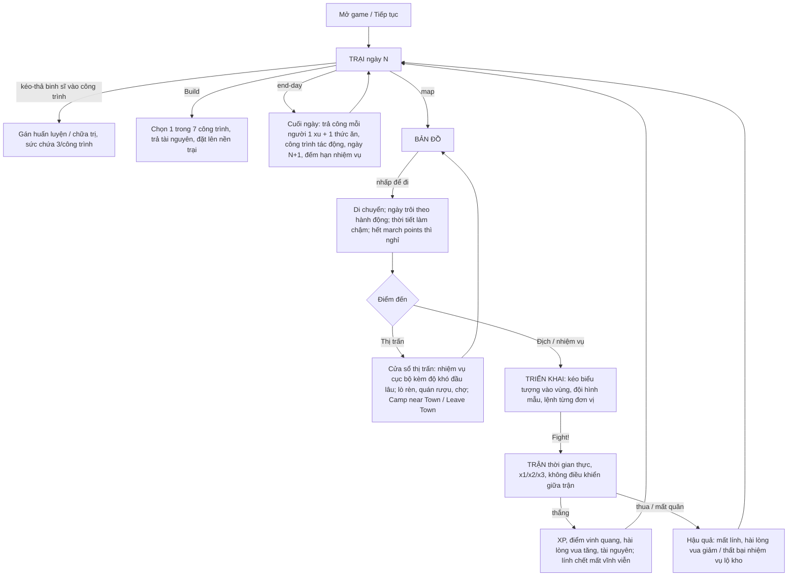

# Rising Army — đặc tả gameplay cốt lõi (từ bằng chứng)

Nhãn bằng chứng theo `RISING_ARMY_GAMEPLAY_FIDELITY_AUDIT.md` (mục # trong ngoặc). **`[V]`** = quan sát trực tiếp, **`[C]`** = CORROBORATED, **`[P]`** = PROPOSED (chuyển thể của tôi vì UNKNOWN; **không phải** gameplay đã xác minh).
Mỗi ô `[P]` phải được thay khi có thêm bằng chứng.

## 1. Có đủ bằng chứng để mô tả vòng lặp cốt lõi không?

**Có, ở mức cấu trúc.** Ảnh và clip chính thức cho thấy trực tiếp ba màn hình cốt lõi (trại, bản đồ, trận) và các hành động chính (kéo-thả vào công trình, đặt công trình, di chuyển trên bản đồ, triển khai quân, "Fight!"). Văn bản của nhà phát triển cho vòng lặp ngày và nhà vua.
**Không đủ** để tái dựng chính xác các công thức (sát thương, tốc độ huấn luyện, giá cả, bổng lộc, mức hài lòng của vua, chi tiết nhiệm vụ). Những phần đó giữ ở `[P]` có nhãn rõ.

## 2. Vòng lặp chuẩn

## 3. Từng bước: hành động, phản hồi, thay đổi, điều kiện

### 3.1 Trại (`[V]` SHOT 1, CLIP 1, 3)
- **Bắt đầu**: cảnh trại một màn hình, hàng rào cọc bao quanh; binh sĩ đi lại; HUD: 7 tài nguyên, thanh vua, ngày, số quân/20, stash, journal; nút `build`, `end-day`, `map`. `[V]`
- **Hành động**: kéo một binh sĩ thả lên công trình có sức chứa (hiển thị `0/3`) → thông báo "Unit added". `[V]` Bấm `build` → 7 biểu tượng công trình → chọn → bóng mờ → đặt. `[V]`
- **Phản hồi**: tooltip mô tả và chi phí; thẻ binh sĩ nhỏ khi chạm. `[V]`
- **Thay đổi khi `end-day`**: ngày +1 `[V]`; mỗi binh sĩ tốn 1 xu + 1 thức ăn mỗi ngày `[C]` (biểu tượng 1/1 trên thẻ + TBL); công trình tác động binh sĩ được gán (huấn luyện: thanh % tăng `[V cấu trúc]`; lều cứu thương: hồi HP/năng lượng `[V]`). **Tốc độ cụ thể `[P]`**.
- **Điều kiện sang bước sau**: bấm `map`.

### 3.2 Bản đồ (`[V]` SHOT 3, CLIP 2)
- **Hành động**: nhấp lên bản đồ liền mạch để di chuyển nhân vật (peon); nút `go to camp`. `[V]`
- **Phản hồi**: thanh "slowed down" khi thời tiết xấu; mây bão/sương hiển thị; dấu ghim cuộn giấy là nhiệm vụ. `[V]`
- **Thay đổi**: ngày trôi theo hành động (đến thị trấn: ngày 1→2). `[V]` March points hạn chế đường dài, hết thì nghỉ. `[C]` Kẻ địch, thú hoang, sự kiện ngẫu nhiên trên đường. `[C]`
- **Điều kiện**: chạm thị trấn → cửa sổ thị trấn; chạm địch/nhiệm vụ → trận.

### 3.3 Thị trấn (`[V]` SHOT 4)
- **Hiển thị**: minh họa (lò rèn, quán rượu, quầy chợ), mô tả, **"Available quests"** (cuộn giấy + số đầu lâu = độ khó), nút `Camp near Town`, `Leave Town`. `[V]`
- **Chức năng thợ rèn/quán rượu/chợ**: cửa hàng làm mới, quán rượu để tuyển và uống hồi HP/tinh thần (tốn tiền), thợ cắt tóc. `[C]` **Giao diện và giá `[P]`**.

### 3.4 Triển khai và trận (`[V]` SHOT 5-7, CLIP 4)
- **Triển khai**: thẻ chân dung ở đáy (kèm biểu tượng vũ khí/tầm); kéo vào vùng bên trái; khung chọn thả nhiều; đếm `7/7`; 4 đội hình mẫu (xúc xắc, "Expanded formation"); `Deploy Units`, `Deploy Buildings`, `ASSIGN_ORDERS`, `Fight!`. `[V]`
- **Trận**: thời gian thực, đơn vị di chuyển/đánh liên tục, vật cản, "Miss", thanh tổng HP hai bên, x1/x2/x3, nút còi. `[V]` Không điều khiển giữa trận. `[V/C]`
- **Thành công/thất bại**: thắng → tăng hài lòng vua và XP `[C]`; điểm vinh quang `[C]`; chết vĩnh viễn `[C]`. **Điều kiện thắng/thua chi tiết, mục tiêu khác ngoài tiêu diệt `[P]`/UNKNOWN**.

### 3.5 Tiến trình dài hạn
- Thanh hài lòng của vua `[V]` quyết định tiến triển và thất bại `[C]`; nhiệm vụ royal (King's Pleasure) vs local (tài nguyên) `[C]`; Talents mở bằng Glory Points `[C]`; chiến dịch ngắn (~3 giờ) `[C]`; mục tiêu cuối **UNKNOWN/CONFLICTING**.

## 4. Ánh xạ game gốc ↔ ứng dụng (kế hoạch tái dựng Phase 4)

| Hạng mục | Game gốc | Ứng dụng trước Phase 4 | Hành động Phase 4 |
|---|---|---|---|
| Trại | Cảnh tương tác, kéo-thả, công trình có sức chứa 3, tự đặt | Cảnh tĩnh + nút điều hướng | **Làm lại**: cảnh với binh sĩ đi lại, kéo-thả vào công trình `n/3`, menu Build đặt công trình |
| Huấn luyện | 3 thuộc tính, thanh % theo công trình | 4 chỉ số, chọn chỉ số, 10 xu, ngày | **Làm lại**: STR/DEX/CON, tiến độ %, theo công trình; tốc độ dẫn xuất |
| Thương tích | HP/năng lượng kéo dài; lều cứu thương hồi | Ngày nghỉ, xác suất chết | **Làm lại**: HP kéo dài, chết khi HP=0, lều cứu thương hồi HP |
| Trận | Thời gian thực, triển khai tự do, x1/x2/x3 | Vòng/hàng/bỏ chạy | **Làm lại**: mô phỏng thời gian thực, triển khai kéo-thả, đội hình mẫu, x1/x2/x3 |
| Bản đồ | Tự do, thời tiết, march points | Nút cố định | **Chưa làm** (UNKNOWN chi tiết), ghi nhận |
| Thị trấn | Quest đầu lâu, lò rèn/quán/chợ | Gian hàng + người bán | Giữ, ghi nhận lệch |
| Nhiệm vụ | royal/local, step, fetch, escort | 17 mẫu tự đặt | Giữ, ghi nhận lệch; không thêm mẫu mới |
| Chiến dịch | ~3 giờ, có thể không có trùm | 100+ ngày + pháo đài | Giữ tạm, **đánh dấu TỰ TẠO** |

## 5. Điều chưa đủ bằng chứng, cần người dùng cung cấp

Ảnh chụp hoặc video có thể giải quyết các điểm sau (xếp theo giá trị cho việc tái dựng):
1. **Màn hình kết quả trận**: XP, glory points, thay đổi hài lòng, danh sách tử trận, loot.
2. **Nhật ký/nhiệm vụ (journal)** và cửa sổ nhận nhiệm vụ: các loại, thưởng, phạt, hạn, "King's Pleasure".
3. **Menu Build đầy đủ**: tên, chi phí, hiệu ứng, sức chứa của 7 công trình; công trình hư hỏng và sửa.
4. **Cửa sổ quán rượu, thợ rèn, chợ**: giá, tuyển mộ, tồn kho.
5. **Bảng binh sĩ ở trận và nút Assign Orders**: danh sách lệnh; ý nghĩa ngọn lửa xanh 22/22 và biểu tượng "1/1".
6. **Cây Talents / Glory Points** và nút còi (hiệu ứng).
7. **Bản đồ khi hành quân**: march points hiển thị thế nào, thời tiết làm chậm bao nhiêu.
8. **Màn hình kết thúc chiến dịch** hoặc điều kiện thắng; 7 tài nguyên tên gì.
9. **Một lượt chơi liên tục dài** (video) để xác nhận nhịp độ ngày, tần suất trận và tốc độ huấn luyện.
